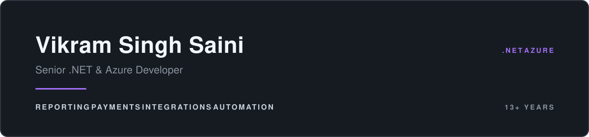

Senior .NET developer, 13+ years, working remote from India. Currently with a US client; before that
nearly five years on a UK contract, and Danish payroll products through a Jaipur agency. I build the
parts of a business that have to be right — reporting engines, payment flows, integrations between
systems that were never meant to talk, and background processing that runs unattended.

Currently contracting on .NET 10 and Azure.

## What I get brought in for

**Document and reporting engines.** A QuestPDF engine producing seven distinct report types from one
component model — multi-level grouping, computed footers, page-break control. Also XFA form
flattening, Crystal Reports, Excel generation and in-browser PDF rendering.

**Azure serverless and integration.** Durable Functions orchestrations, webhook endpoints with
signature validation, OAuth token lifecycles refreshed before they expire, rate-limit handling and
Polly resilience policies. Key Vault, Service Bus, Application Insights, Power BI Embedded.

**Payments and money-critical flows.** Clover checkout with idempotency keys so a retried payment
cannot double-charge, signed webhooks, correlation IDs through the logs, and the timezone and encoding
details that only surface against a real downstream consumer.

**Getting data out of systems that will not give it.** Four supplier portals automated with Selenium
and PuppeteerSharp including a Cloudflare interstitial; a third-party HR desktop application driven
through Appium and WinAppDriver with no API at all; price books parsed out of supplier PDFs.

**Active Directory, in depth.** Bulk group and user management across domains and child domains, LDAP
range retrieval for groups too large to read in one pass, fine-grained password policy, Exchange
mailbox provisioning. Nearly five years of it.

## Selected work

**Imagine Nation Software** · 2023 – present · *contract*  
A .NET 9 reporting engine for a Los Angeles trade union, on QuestPDF with MediatR CQRS and Dapper, two
years of sustained development. For a US healthcare provider, a Clover payment service and a
RingCentral voicemail pipeline on Azure Durable Functions.

**Everconnect DS** · 2023 – 2024 · *US client*  
CSI, a price-intelligence system: a WinForms application signing in to four supplier portals to
capture price and stock, and a .NET 8 Clean Architecture web application over the results. Also UMG,
a royalty statement portal on .NET 7 with an Angular front end, Firebase authentication, Redis and
Application Insights. Plus Windows desktop automation of a third-party HR application through Appium
and WinAppDriver, and single sign-on against Amazon Cognito for their own client, with the ASP.NET
integration library written by hand rather than taken off the shelf.

**Upwork, US client** · 2023  
PDF-to-Excel conversion for supplier price books, handling multiple tables per page and nested
size groupings.

**Sumedha Softech** · 2019 – 2023  
For Zenegy, the Danish payroll platform: payroll transfer from Planday on Hangfire and Azure SignalR,
and calendar integrations into Google and Microsoft 365. For Boatflex: user management on
IdentityServer 4 with social logins and breached-password checking. Also garaaz.com and its mobile API.

**Dovestones Software Ltd** · 2014 – 2019 · *freelance, UK, 4 yrs 10 mos*  
Remote developer on a suite of Active Directory tools used by businesses, schools and colleges
worldwide. My longest engagement; written reference available.

**IOCL Rajasthan** · built 2013 – 2014  
My first web application: a departmental intranet on ASP.NET with Active Directory authentication,
delegated per-department administration, and bilingual English and Hindi content. Built single-handed.

## Repositories worth a look

| | |
| --- | --- |
| [PdfGenerator](https://github.com/vssaini/PdfGenerator) | .NET 9 · QuestPDF reporting engine, seven document types, two years of work |
| [NocturnaVoicemailWorkflow](https://github.com/vssaini/NocturnaVoicemailWorkflow) | .NET 8 · Azure Durable Functions, RingCentral webhooks, Polly, proactive token refresh |
| [Scrapper](https://github.com/vssaini/Scrapper) | .NET 8 · Clean Architecture and CQRS, domain events, Dapper read path |
| [CSI-Scraping](https://github.com/vssaini/CSI-Scraping) | WinForms · Selenium and PuppeteerSharp across four portals, PDF and Excel ingest |
| [ImportEmailsFromG-MS](https://github.com/vssaini/ImportEmailsFromG-MS) | Microsoft Graph and Gmail OAuth side by side, separate token stores |
| [PowerBI-RLS-AzureAD](https://github.com/vssaini/PowerBI-RLS-AzureAD) | Power BI Embedded with row-level security via an Azure AD service principal |

## Tech

**Core** — C#, .NET 10, 8 and 6, ASP.NET Core, EF Core, Dapper, SQL Server  
**Azure** — Functions and Durable Functions, SQL, App Service, Key Vault, Service Bus, Application Insights, Power BI Embedded  
**Patterns** — Clean Architecture, CQRS with MediatR, DDD, Result types, Polly  
**Also** — WinForms, WPF, Angular, TypeScript, Selenium, Puppeteer, Appium, QuestPDF, Serilog and Seq, Hangfire, SignalR, IdentityServer 4, Microsoft Graph, GitHub Actions, Azure Pipelines

## About this profile

Most of my work sits in private client repositories and Azure DevOps, so the contribution graph here
is not a measure of activity. The public repositories are proofs of concept and technique spikes; the
shipped work is behind the engagements above.

📫 [LinkedIn](https://www.linkedin.com/in/vssaini/)
